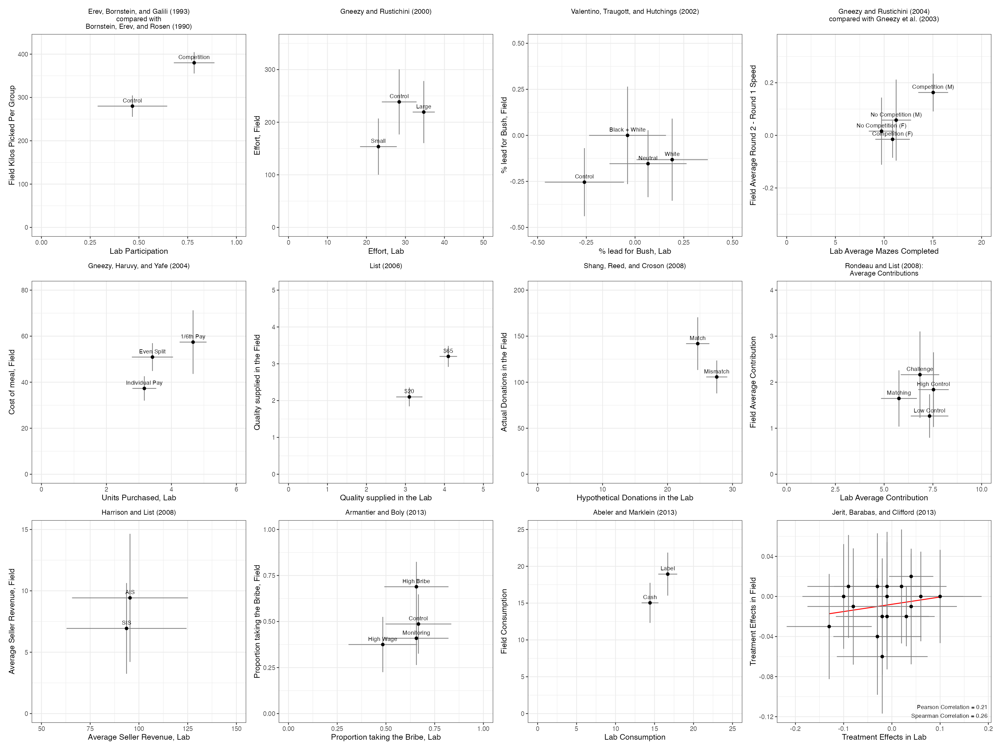
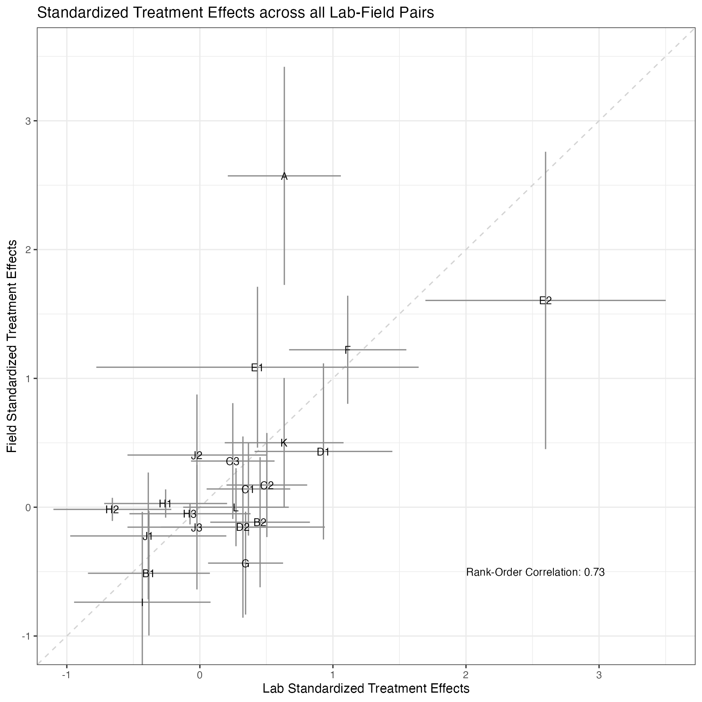
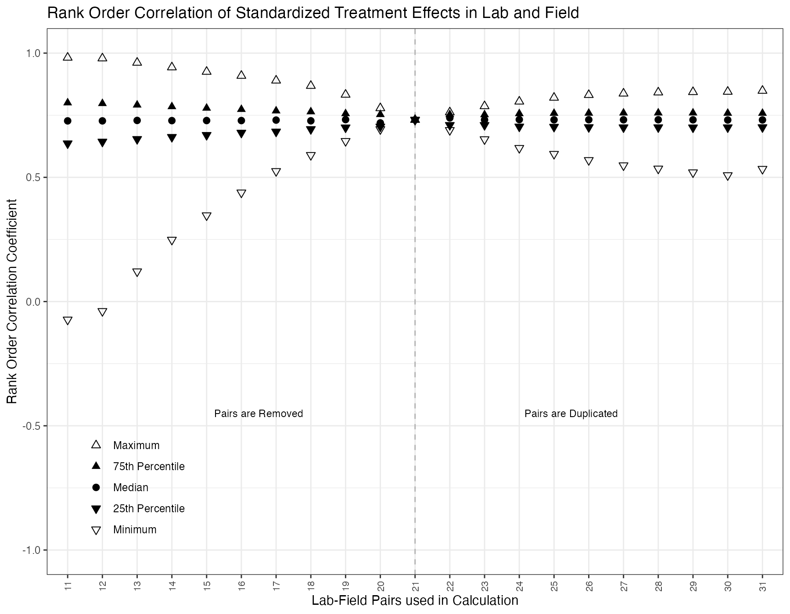

# Reproducibility Report: Coppock and Green (2015)


- [Summary](#summary)
  - [Does the deposited archive run?](#does-the-deposited-archive-run)
  - [Does the maintained rewrite reproduce the
    paper?](#does-the-maintained-rewrite-reproduce-the-paper)
- [Paper overview](#paper-overview)
- [Original archive reproducibility](#original-archive-reproducibility)
  - [What the archive regenerates](#what-the-archive-regenerates)
  - [Figure 3 and the sampler](#figure-3-and-the-sampler)
- [Errata](#errata)
  - [The reliability is squared](#the-reliability-is-squared)
  - [The female treatment effect is standardized by a male treatment
    group](#the-female-treatment-effect-is-standardized-by-a-male-treatment-group)
  - [The List (2006) field standard error is the lab standard
    error](#the-list-2006-field-standard-error-is-the-lab-standard-error)
  - [What the three corrections do](#what-the-three-corrections-do)
- [Number-by-number comparison](#number-by-number-comparison)
- [Maintained rewrite](#maintained-rewrite)
  - [Architecture](#architecture)
  - [Deprecated patterns replaced](#deprecated-patterns-replaced)
- [Figures](#figures)
- [Maintained rewrite verification](#maintained-rewrite-verification)
- [R environment](#r-environment)

*Drafted by Claude Opus 5 under the supervision of Alex Coppock.*

This repository holds the actively maintained replication code for
Coppock and Green (2015), together with the reproducibility report that
documents what the original archive did and did not do. It is part of a
program applying the maintenance proposal in Peer, Orr and Coppock
(2021, *PS: Political Science & Politics*, doi
[10.1017/S1049096521000366](https://doi.org/10.1017/S1049096521000366))
to a set of published archives.

|  |  |
|----|----|
| Article | [10.1017/psrm.2014.10](https://doi.org/10.1017/psrm.2014.10) |
| Replication archive | [10.7910/DVN/25543](https://doi.org/10.7910/DVN/25543) |

**The data are not redistributed here.** The deposit is a single 52 KB
RAR container holding 16 files, and it lives at Harvard Dataverse, which
is the only copy this repository points at. `download_original.R`
fetches it, verifies it, unpacks it and verifies each of the 16 members;
`original_manifest.csv` pins the container and
`original_members_manifest.csv` pins its contents, so the exact bytes
this code was written against are recorded in version control even
though the bytes themselves are not.

**Repository layout.** `maintained/` is the maintained rewrite: one
script per published table or figure, writing to `output/`, which is
committed so a reader can compare a fresh run against it without
downloading anything. `ground_truth/` ties every published number to the
code that produces it, and `build_ground_truth.R` assembles that table
by reading every rewrite value back out of `maintained/output/`, so it
cannot drift from the scripts. `original/` and `original_extracted/` are
created by the download script and are deliberately absent from the
repository. This file is the reproducibility report, also available as a
PDF in `report/`.

**License.** CC0 1.0 Universal, matching the terms of the deposit this
repository maintains. See `LICENSE`.

**To reproduce.** Clone or download the repository, open
`coppock_green_2015.Rproj`, and run:

``` r
source("run_all.R")
```

That fetches the deposit, verifies it, produces every table and figure
into `maintained/output/`, and rebuilds the ground truth from those
outputs as its last step. Required packages: tidyverse, estimatr,
modelsummary, patchwork, knitr, kableExtra, archive, here. Paths resolve
through `here`, so nothing depends on the working directory. The full
run takes about 40 seconds, almost all of it in the two scripts that
enumerate subsets of the 21 lab-field pairs: `figure_3_robustness.R`
evaluates the rank-order correlation across 555,790 subsets, and
`text_sampler_reproducibility.R` runs the same enumeration twice, once
under each of R’s two samplers. A successful run overwrites
`maintained/output/`, which is committed: **`git diff` on that folder is
the reproduction check.** Expect the CSV, TeX and PNG output to come
back byte-identical and the three PDF figures to differ, because a PDF
records the time it was written.

# Summary

Two questions, answered before the detail.

## Does the deposited archive run?

Yes, after one edit and two installations. Five of the six analysis
scripts execute without error on a current R installation. The sixth,
`Coppock Green Lab Field Appendix Table Code.R`, calls `setwd("")` on
its seventh line and stops there; commenting that line out is the whole
fix. Three of the scripts call `gplots` and `calibrate`, which have to
be installed but do install from CRAN today, at versions 3.3.0 and
1.7.7.

Running is also reproducing, with one qualification. Of the five files
the archive both writes and deposits, four come back unchanged:
`meanstable.csv` character for character apart from line endings,
`setoftwelve.rdata` to within 5e-16, and the two PDF figures with every
mark in the same place. The fifth, `rankorderrobustness.pdf`, cannot
come back unchanged, because footnote 6 samples 50,000 of the larger
combination sets at random and R replaced the sampler behind `sample()`
in version 3.6.0. That is a property of the environment rather than a
defect in the deposit, and the section on Figure 3 below measures how
much it moves.

Of the 25 published quantities an archive script can be checked against,
23 match the article to the precision the article prints. The 2 that do
not are both the article’s, not the code’s: footnote 5 truncates
0.6995778 to 0.699 where the third decimal rounds to 0.700, and the
text’s assertion that the median correlation “stays constant across all
permutations” is not what the archive’s own procedure produces.

The one thing the archive cannot do is defend itself. Four of its six
scripts write their outputs into the directory they are run from, and
five of those outputs are themselves deposited files, so running the
archive in place overwrites part of the deposit with the run’s own
output. That is why `download_original.R` unpacks into
`original_extracted/` and leaves `original/` holding the container
alone, and why the checks in this report were run in a scratch copy.

## Does the maintained rewrite reproduce the paper?

Yes for the headline result, and it corrects three errors along the way.
38 of the 46 verifiable claims match the published values to reported
precision, including the Spearman rank-order correlation of 0.73 that
the abstract leads with. Seven of the 8 that do not are the
disattenuation calculation in the Discussion and the two bounds of
footnote 5, and each of those differs because the rewrite corrects an
error rather than because it fails to reproduce one; the Errata section
below sets out all three corrections. The eighth is the sentence about
Figure 3 saying that the median correlation stays constant, which is not
true of the archive’s output either.

The largest of the three is the disattenuated correlation, which the
paper reports as 0.80 and the rewrite puts at 0.73. Footnote 7 defines
the reliability of a treatment effect as the *square* of the correlation
between two simulated draws, and the archive implements that definition
faithfully. Spearman’s correction for attenuation takes the reliability
to be the correlation itself, so squaring it first inflates the
corrected estimate. Correcting the definition, and two indexing errors
that shift the raw correlation from 0.64 to 0.65, gives 0.73. The
published conclusion is unaffected in direction: the disattenuated
correlation still exceeds the observed one, and lab-field correspondence
is still strong.

# Paper overview

**Citation**: Coppock, A. and Green, D. P. (2015). “Assessing the
correspondence between experimental results obtained in the lab and
field: A review of recent social science research.” *Political Science
Research and Methods*, 3(1), 113-131. DOI: 10.1017/psrm.2014.10

**Summary**: The article reviews the literature comparing experimental
results obtained in laboratory and field settings, and reanalyzes twelve
pairs of studies conducted in parallel across the two. Because the
outcome scales are incomparable across pairs (mazes solved against
footrace times, hypothetical donations against real ones),
correspondence is assessed by rank-order correlation rather than by
comparing effect sizes directly. Each study’s treatment effects are
standardized by the control group standard deviation, which yields 21
lab-field pairs of standardized effects across the twelve studies. The
Spearman rank-order correlation of those 21 pairs is 0.73, and a
leave-out and duplicate-in robustness exercise shows the interquartile
range staying within a band of about 0.6 to 0.8 under every way of
dropping or duplicating up to ten pairs. The article closes by noting
that the set of available lab-field comparisons is itself an ad hoc and
possibly selected one, and calls for comparisons designed rather than
found.

# Original archive reproducibility

The deposit is one RAR container with 16 files: six analysis scripts,
one duplicate script, one data file, a readme, five deposited outputs,
and two files the author’s operating system and R session left behind
(`.DS_Store` and a 26 KB `.Rhistory`).

| Script | Status on current R | Resolution |
|:---|:---|:---|
| Coppock Green Lab Field Tables 1 and 2 Code.R | Clean | No changes required |
| Coppock Green Lab Field Figure 1 Code.R | Clean once gplots and calibrate are installed | install.packages(c(‘gplots’, ‘calibrate’)) |
| Coppock Green Lab Field Figure 2 Code.R | Clean once gplots and calibrate are installed | install.packages(c(‘gplots’, ‘calibrate’)) |
| Coppock Green Lab Field Figure 3 Code.R | Clean once gplots and calibrate are installed | install.packages(c(‘gplots’, ‘calibrate’)) |
| Coppock Green Lab Field Appendix Table Code.R | Stops on line 7 | Comment out setwd(““) |
| Coppock Green Lab Field Disattenuation Code.R | Clean | No changes required |
| tables1and2.r | Undocumented duplicate of the Tables 1 and 2 script, minus its header | None needed; not run |

Original archive reproducibility, checked against R 4.6.0.

`setwd("")` is a placeholder the author left uncommented in one script
out of six. The same line is present but commented out in four of the
other five, which is what makes the omission legible as an oversight
rather than a design. `gplots` and `calibrate` are both still on CRAN
and both install without incident, at 3.3.0 and 1.7.7; a report of
missing packages is a report about a machine, not about availability.

Figure 3’s script is a small curiosity: it calls `library(gplots)` at
line 74, well after the loop that computes every number the figure
reports. On a machine without `gplots` it therefore prints all of its
results and then fails at the plotting stage, which is a more forgiving
failure than it looks.

## What the archive regenerates

Four scripts write files, and five of the files they write are deposited
alongside them. Re-running the archive from a scratch copy regenerates
four of the five exactly and the fifth up to the random sampling the
article documents.

| Deposited output | Produced by | Regenerated result |
|:---|:---|:---|
| meanstable.csv | Appendix Table Code.R | Identical apart from line endings |
| setoftwelve.rdata | Figure 2 Code.R | Identical to within 5e-16 |
| tiles_landscape.pdf | Figure 1 Code.R | Every mark in the same place; the file differs only in how the current PDF device encodes plotting symbols |
| standardized.pdf | Figure 2 Code.R | Every mark in the same place; the file differs only in how the current PDF device encodes plotting symbols |
| rankorderrobustness.pdf | Figure 3 Code.R | Coordinates differ; Figure 3 samples 50,000 of the larger combination sets and R 3.6.0 changed the sampler |

What the deposited code produces today, compared with the outputs
deposited beside it.

The two PDF results deserve the qualifier they carry. Neither file is
byte-identical to its deposited twin, and decompressing the content
streams shows that every difference is one of two changes in R’s PDF
device rather than a change in the plot. An open plotting symbol used to
be written as a glyph from the symbol font and is now written as a
Bézier path drawn at the same centre: 42 symbols in `standardized.pdf`
and 147 in `tiles_landscape.pdf`. A closed polyline that used to end
`l S` now ends `h S`, once in the first file and twelve times in the
second. Rendering both versions of each figure at 200 dpi and
differencing them changes 0.02 per cent of the pixels in each, all of
them on the anti-aliased edges of those redrawn symbols, and nothing
anywhere else on either page.

That is a stronger result than it sounds. The archive’s numbers are the
paper’s numbers, and the code that produced them still produces them.

## Figure 3 and the sampler

`rankorderrobustness.pdf` is the exception, and the reason is in the
article. Footnote 6 records that when more than 50,000 combinations are
available, 50,000 of them are sampled at random. R 3.6.0 replaced the
algorithm behind `sample()`, so code written in 2014 draws different
subsets today at the same seed, and the archive’s Figure 3 draws at ten
of its twenty subset sizes.

`maintained/text_sampler_reproducibility.R` measures that directly. It
runs the archive’s own procedure twice on the archive’s own deposited
effects, once with `RNGkind(sample.kind = "Rounding")` to restore the
sampler of the day and once under the current default, and compares the
100 summary values behind the figure.

| Quantity                                | Value  |
|:----------------------------------------|:-------|
| Summary values compared                 | 100    |
| Values identical under the two samplers | 74     |
| Values differing by 0.005 or more       | 6      |
| Largest absolute difference             | 0.0736 |

The archive’s Figure 3 procedure run under the sampler of 2014 and under
the current one.

The five-number summary is barely moved: most values are identical and
the largest change is 0.074, at the extremes where a single unlucky
subset can be drawn or missed. The maintained rewrite keeps the current
sampler, because it is the code we would write now. Where that moves a
number, the difference belongs to R rather than to either analysis.

# Errata

Three errors, all of them in the archive rather than introduced by it,
and all of them corrected in the rewrite. None changes the article’s
conclusion.

## The reliability is squared

`Coppock Green Lab Field Disattenuation Code.R` estimates the
reliability of the lab and field treatment effects by simulation: for
each of the 21 pairs it draws two treatment effects from the normal
distribution implied by the estimate and its standard error, correlates
the first draws against the second, and averages over 10,000
simulations. The line that stores the result squares it:

``` r
lab.relys[j] <- cor(draw1.lab, draw2.lab)^2
```

Footnote 7 of the article says the same thing in words: “The estimated
reliability is the square of the correlation between two treatment
effect draws.” Code and text agree, and both are wrong. Under classical
test theory the reliability of a measure is the correlation between two
parallel measurements of it, and Spearman’s correction for attenuation
divides the observed correlation by the geometric mean of the two
reliabilities. Squaring the correlations before averaging them makes the
denominator too small and the corrected estimate too large. The error
was identified by David Broockman (UC Berkeley) in January 2024. No
corrigendum has been published, so this repository is where the
correction is recorded. Broockman’s own figures, computed without the
two indexing corrections described next, put the field reliability at
0.91 and the disattenuated correlation at 0.72; the rewrite’s 0.90 and
0.73 differ from them for that reason.

## The female treatment effect is standardized by a male treatment group

`Coppock Green Lab Field Figure 2 Code.R` computes two standardized
treatment effects for the Gneezy and Rustichini (2004) comparison, one
for men and one for women. The male effect contrasts row 3 (Competition,
M) against row 1 (No Competition, M); the female effect contrasts row 4
(Competition, F) against row 2 (No Competition, F). Both are then
standardized:

``` r
s.gender.lab.tes <- gender.lab.tes / gender.lab.sds[c(1, 3)]
```

The first divisor is right: row 1 is the male control group. The second
is not: row 3 is the male *treatment* group, where the female
comparison’s control group is row 2. Equation 1 of the article is
explicit that the divisor is the control group standard deviation. The
same `c(1, 3)` index appears eight times in the script, four times for
the lab quantities and four times for the field, so the estimate, both
interval bounds and the standard error are all affected in both
settings. The rewrite standardizes the female effect by row 2, which is
what the equation says and what every other pair in the paper does.

## The List (2006) field standard error is the lab standard error

The same script assembles the List (2006) results:

``` r
list.field.tes.ses <- c(list.lab.2.1[4])
```

Every neighboring line reads its value from `list.field.2.1`; this one
reads from `list.lab.2.1`. The standard error does not enter Figure 2,
whose intervals come from separately stored bounds, so the published
figure is unaffected. It does enter the reliability simulation, which
draws from the standard errors, so it moves the field reliability and
through it the disattenuated correlation.

## What the three corrections do

| Quantity | Published | Indexing fixed only | Indexing and reliability fixed |
|:---|:---|:---|:---|
| Raw Pearson correlation, 21 pairs | 0.64 | 0.65 | 0.65 |
| Lab reliability | 0.78 | 0.78 | 0.88 |
| Field reliability | 0.82 | 0.82 | 0.90 |
| Disattenuated correlation | 0.80 | 0.81 | 0.73 |

The disattenuation calculation under the published definition and under
the corrected one. The middle column keeps footnote 7’s squared
reliability and fixes only the two indexing errors; the right column is
what the rewrite reports.

The two indexing errors alone move the disattenuated correlation from
0.80 to 0.81. Correcting the reliability definition as well moves it to
0.73. Both reliabilities rise sharply, from 0.78 to 0.88 in the lab and
from 0.82 to 0.90 in the field, because a correlation near 0.9 is much
larger than its own square.

The rank-order correlation the paper leads with is untouched: it moves
from 0.7275 to 0.7314, which rounds to 0.73 either way. The two bounds
in footnote 5, which report how far the pooled correlation moves as the
single included Jerit, Barabas and Clifford pair varies across the 17
candidates, shift from 0.699 and 0.762 to 0.705 and 0.767. Since the
indexing correction also reorders the 17 candidates, the median case is
now candidate 12 rather than candidate 3.

# Number-by-number comparison

| Location | Quantity | Paper | Archive | Match |
|:---|:---|:---|:---|:---|
| Table 1 | Pair 1, lab ATE | 2 |  |  |
| Table 1 | Pair 1, field ATE | 0.5 |  |  |
| Table 1 | Pair 2, lab ATE | 5 |  |  |
| Table 1 | Pair 2, field ATE | 4 |  |  |
| Table 1 | Pair 3, lab ATE | 3 |  |  |
| Table 1 | Pair 3, field ATE | 3 |  |  |
| Table 1 | Pair 4, lab ATE | 0 |  |  |
| Table 1 | Pair 4, field ATE | 3 |  |  |
| Table 1 | Pair 5, lab ATE | 2 |  |  |
| Table 1 | Pair 5, field ATE | -1.5 |  |  |
| Table 1 | Pair 6, lab ATE | 0.5 |  |  |
| Table 1 | Pair 6, field ATE | 4 |  |  |
| Table 1 | Pair 7, lab ATE | -2 |  |  |
| Table 1 | Pair 7, field ATE | 1.5 |  |  |
| Table 1 | Pair 8, lab ATE | -2 |  |  |
| Table 1 | Pair 8, field ATE | 2 |  |  |
| Table 2 | Subjects (A) | 2 | 2 | 1 |
| Table 2 | Treatments (T1) | 1 | 1 | 1 |
| Table 2 | Outcomes (Effort) | 1 | 1 | 1 |
| Table 2 | Contexts (Field) | 1 | 1 | 1 |
| Table 2 | Constant | -0.94 | -0.9375 | 1 |
| Table 3 | Parallel lab-field study pairs | 12 | 12 | 1 |
| Text, p. 121 | Correlation across the eight hypothetical pairs | 0.14 |  |  |
| Text, p. 121 | Correlation when Pairs 1 and 5 go unreported | 0.76 |  |  |
| Figure 1 | Jerit panel, Pearson correlation | 0.21 | 0.211055 | 1 |
| Figure 1 | Jerit panel, Spearman correlation | 0.26 | 0.259963 | 1 |
| Figure 2 | Pooled treatment effect pairs | 21 | 21 | 1 |
| Figure 2 | Rank-order correlation printed on the figure | 0.73 | 0.727509 | 1 |
| Abstract | Rank-order correlation | 0.73 | 0.727509 | 1 |
| Footnote 5 | Jerit candidate pairs | 17 | 17 | 1 |
| Footnote 5 | Lowest pooled rho across the candidates | 0.699 | 0.699578 | 0 |
| Footnote 5 | Highest pooled rho across the candidates | 0.762 | 0.761936 | 1 |
| Footnote 5 | Pooled rho including all 17 Jerit pairs | 0.56 |  |  |
| Footnote 6 | Combinations sampled where more than 50,000 exist | 50000 | 50000 | 1 |
| Figure 3 | Lowest 25th percentile across the combination sizes |  | 0.633259 |  |
| Figure 3 | Highest 75th percentile across the combination sizes |  | 0.790909 |  |
| Figure 3 | Interquartile range stays within 0.6 to 0.8 across every combination size | 1 | 1 | 1 |
| Figure 3 | Minimum correlation crosses zero when any ten pairs are dropped | 1 | 1 | 1 |
| Figure 3 | Distinct values of the median correlation, to two decimal places | 1 | 2 | 0 |
| Figure 3 | Largest change in a plotted summary value under the R 3.6 sampler |  | 0.0735553 |  |
| Discussion | Median lab sample size per treatment condition | 40 |  |  |
| Discussion | Median field sample size per treatment condition | 37.5 |  |  |
| Discussion | Raw Pearson correlation across the 21 pairs | 0.64 | 0.642814 | 1 |
| Discussion | Lab reliability | 0.78 | 0.78334 | 1 |
| Discussion | Field reliability | 0.82 | 0.823976 | 1 |
| Discussion | Disattenuated correlation | 0.8 | 0.800116 | 1 |
| Footnote 7 | Lab reliability under the published definition | 0.78 | 0.78334 | 1 |
| Footnote 7 | Field reliability under the published definition | 0.82 | 0.823976 | 1 |
| Footnote 7 | Disattenuated correlation under the published definition | 0.8 | 0.800116 | 1 |
| Online Appendix Table 1 | Treatment condition rows |  | 32 |  |
| Online Appendix Table 1 | Cells agreeing with the deposited meanstable.csv |  | 192 |  |
| Online Appendix Table 2 | Descriptions of the twelve study pairs |  |  |  |

Ground truth: published value against the value the deposited scripts
produce on current R. A blank Archive cell means no deposited script
computes the quantity; a blank Paper cell means the article and its
available appendix do not state it.

Of the 52 recorded claims, 25 can be compared against what a deposited
script prints, and 23 of those match the published value. 2 fail, and in
both the article is the party at fault. The first is footnote 5, which
gives the range of pooled correlations as 0.699 to 0.762 where the
script prints 0.6995778, a value that rounds up to 0.700 at the three
decimals the footnote uses. The second is the sentence describing Figure
3, which says the median correlation “stays constant across all
permutations”, where the archive’s own procedure gives 2 distinct values
at two decimal places, running from 0.720 to 0.729. Neither changes
anything the paper concludes, and neither is a failure of the code.

Beyond the stipulated entries of Table 1, five quantities the article
states are ones no deposited script computes: the two correlations
quoted from the Table 1 illustration, the pooled correlation when all 17
Jerit pairs are included, and the two median sample sizes in the
Discussion. All five are recoverable from the deposited data and all
five reproduce; the rewrite adds `text_hypothetical_correlations.R`,
`text_jerit_sensitivity.R` and `text_median_sample_sizes.R` to compute
them.

6 rows have no published value to compare against. 2 of them concern
Online Appendix Table 1, the table of group means behind every panel of
Figure 1. The appendix published with the article is the bibliography of
the roughly 80 studies considered for inclusion, and neither of the two
online appendix tables the text refers to is in it, so the 192 cells of
that table cannot be checked against a published source. They are
checked instead against `meanstable.csv`, the deposit’s own copy of the
table, and all 192 agree exactly at the published rounding. One row is
Online Appendix Table 2, which is prose. The other 3 are Figure 3, which
plots points and prints no numbers.

# Maintained rewrite

The rewrite lives in `maintained/`: a shared `helpers.R` and thirteen
scripts covering one cleaning step, three published tables, three
published figures, five sets of in-text quantities, and the sampler
comparison behind the Figure 3 section above. It is a translation, not a
reanalysis, except for the three errata above: every estimator,
standardization and sample definition is the one the paper used.

## Architecture

`clean_labfield.R` is the only script that touches the deposit. It reads
the twelve data frames in `labfieldframes.rdata`, tidies the group means
into one long table, and computes the 21 standardized treatment effects
from the group means, standard deviations and sizes, following Equations
1 and 2 of the article. Everything downstream reads its two outputs.

The original code carries the study prefix in every column name, so
`erev.frame` has an `erev.lab.means` column and `gneezy.frame` has a
`gneezy.lab.means` column, and it reaches them by calling `attach()` on
all twelve frames in turn. The rewrite strips the prefixes once, in
`normalize_frame()`, and drives everything from an explicit table of
study specifications: which frame, which column holds the condition
labels, which rows form each treatment-control contrast, and which row’s
standard deviation standardizes it. The three errata are one-character
changes in that table rather than edits scattered through 431 lines.

Armantier and Boly’s outcome is binary, so its effects are differences
in proportions rather than differences in means, and the archive handles
it by writing out eight vectors of zeros and ones by hand. Those vectors
are not free-floating constants: each is exactly determined by the group
size and group mean in `boly.frame`, so the rewrite rebuilds them with
`binary_group()` and no count is typed into the code.

The hypothetical treatment effects of Table 1 are the one set of numbers
the rewrite does type in, because they are the paper’s stipulated
premises rather than estimates of anything. They are written once, in
`table_1_hypothetical_ates.R`, and both the Table 2 regression and the
two correlations quoted in the text read them back from that script’s
committed output rather than repeating them. The archive types them
twice, once in each of its two copies of the Tables 1 and 2 script.

## Deprecated patterns replaced

| Original pattern | Replacement |
|:---|:---|
| `rm(list = ls())` | (omitted) |
| `setwd("")` | `here::here()` |
| `attach(frame)`, twelve times per script | `normalize_frame()` and explicit `$` access |
| `gplots::plotCI(err = "x")` / `plotCI(err = "y")` | `geom_linerange()` |
| `calibrate::textxy()` | `geom_text()` |
| `xtable` + `print.xtable` | `knitr::kable()`, plus `write_csv()` to `output/` |
| `lm()` | `estimatr::lm_robust()`, and `modelsummary()` for the table |
| `pdf()` / `dev.off()` | `ggsave()` |
| `par(mfrow = c(3, 4))` | `patchwork::wrap_plots()` |
| `data.frame()` | `tibble()` |
| `for` loops over preallocated `rep(NA, n)` vectors | `map()` returning tibbles, `list_rbind()` |
| hardcoded figure legends | values computed and formatted at plot time |

Deprecated patterns and their replacements in the maintained rewrite.

Two of these deserve a word. The archive’s Figure 1 legend reads
`legend(..., legend = c("Pearson Correlation = 0.21", "Spearman Correlation = 0.26"))`,
with the numbers typed in, ten lines below the `cor()` calls that
compute them. They happen to be right. The rewrite formats the computed
values into the annotation, so the figure cannot drift from the data
behind it. Second, the rewrite’s Figure 1 keeps each panel’s own axis
labels and limits, which is why it assembles twelve separate plots with
`patchwork` rather than faceting: `facet_wrap()` would force one pair of
axis labels on all twelve, and the panels measure kilos of oranges, maze
completions, restaurant bills and bribe-taking rates.

# Figures







Figure 3 is the one result that cannot be reproduced exactly, for the
two reasons set out above: footnote 6’s random sampling of 50,000
combinations, and the change of sampler in R 3.6.0. The archive and the
rewrite also consume the random stream in a different order, so they
would draw different subsets even under one sampler. What the figure
claims is unaffected. Across every combination size the archive’s lowest
25th percentile is 0.633 and its highest 75th percentile is 0.791; in
the rewrite they are 0.636 and 0.800. The article’s claim is that the
interquartile range stays within a band of about 0.6 to 0.8, and both
runs put it there. Its other claim about the figure, that the minimum
correlation crosses zero once any ten pairs are dropped, also holds in
both.

The one thing the figure’s accompanying sentence gets wrong is the
median. The text says it “stays constant across all permutations”. It
does not, in either run: the rewrite’s median takes 3 distinct values at
two decimal places, running from 0.719 to 0.739. The variation is small
enough that the substantive point survives, but constant it is not.

The reliability simulation is a different matter, and there the rewrite
matches the archive’s random draw exactly rather than approximately. The
archive draws in the order lab, lab, field, field for each pair before
moving to the next pair and then to the next simulation;
`text_disattenuation.R` hands `rnorm()` its means in that same order, so
the two runs consume identical streams and the difference between their
reliabilities is entirely attributable to the corrections rather than
partly to Monte Carlo noise.

# Maintained rewrite verification

| Location | Quantity | Paper | Rewrite | Match |
|:---|:---|:---|:---|:---|
| Table 1 | Pair 1, lab ATE | 2 | 2 | 1 |
| Table 1 | Pair 1, field ATE | 0.5 | 0.5 | 1 |
| Table 1 | Pair 2, lab ATE | 5 | 5 | 1 |
| Table 1 | Pair 2, field ATE | 4 | 4 | 1 |
| Table 1 | Pair 3, lab ATE | 3 | 3 | 1 |
| Table 1 | Pair 3, field ATE | 3 | 3 | 1 |
| Table 1 | Pair 4, lab ATE | 0 | 0 | 1 |
| Table 1 | Pair 4, field ATE | 3 | 3 | 1 |
| Table 1 | Pair 5, lab ATE | 2 | 2 | 1 |
| Table 1 | Pair 5, field ATE | -1.5 | -1.5 | 1 |
| Table 1 | Pair 6, lab ATE | 0.5 | 0.5 | 1 |
| Table 1 | Pair 6, field ATE | 4 | 4 | 1 |
| Table 1 | Pair 7, lab ATE | -2 | -2 | 1 |
| Table 1 | Pair 7, field ATE | 1.5 | 1.5 | 1 |
| Table 1 | Pair 8, lab ATE | -2 | -2 | 1 |
| Table 1 | Pair 8, field ATE | 2 | 2 | 1 |
| Table 2 | Subjects (A) | 2 | 2 | 1 |
| Table 2 | Treatments (T1) | 1 | 1 | 1 |
| Table 2 | Outcomes (Effort) | 1 | 1 | 1 |
| Table 2 | Contexts (Field) | 1 | 1 | 1 |
| Table 2 | Constant | -0.94 | -0.9375 | 1 |
| Table 3 | Parallel lab-field study pairs | 12 | 12 | 1 |
| Text, p. 121 | Correlation across the eight hypothetical pairs | 0.14 | 0.139999 | 1 |
| Text, p. 121 | Correlation when Pairs 1 and 5 go unreported | 0.76 | 0.764266 | 1 |
| Figure 1 | Jerit panel, Pearson correlation | 0.21 | 0.211055 | 1 |
| Figure 1 | Jerit panel, Spearman correlation | 0.26 | 0.259963 | 1 |
| Figure 2 | Pooled treatment effect pairs | 21 | 21 | 1 |
| Figure 2 | Rank-order correlation printed on the figure | 0.73 | 0.731406 | 1 |
| Abstract | Rank-order correlation | 0.73 | 0.731406 | 1 |
| Footnote 5 | Jerit candidate pairs | 17 | 17 | 1 |
| Footnote 5 | Lowest pooled rho across the candidates | 0.699 | 0.705424 | 0 |
| Footnote 5 | Highest pooled rho across the candidates | 0.762 | 0.767132 | 0 |
| Footnote 5 | Pooled rho including all 17 Jerit pairs | 0.56 | 0.558066 | 1 |
| Footnote 6 | Combinations sampled where more than 50,000 exist | 50000 | 50000 | 1 |
| Figure 3 | Lowest 25th percentile across the combination sizes |  | 0.636364 |  |
| Figure 3 | Highest 75th percentile across the combination sizes |  | 0.8 |  |
| Figure 3 | Interquartile range stays within 0.6 to 0.8 across every combination size | 1 | 1 | 1 |
| Figure 3 | Minimum correlation crosses zero when any ten pairs are dropped | 1 | 1 | 1 |
| Figure 3 | Distinct values of the median correlation, to two decimal places | 1 | 3 | 0 |
| Figure 3 | Largest change in a plotted summary value under the R 3.6 sampler |  |  |  |
| Discussion | Median lab sample size per treatment condition | 40 | 40 | 1 |
| Discussion | Median field sample size per treatment condition | 37.5 | 37.5 | 1 |
| Discussion | Raw Pearson correlation across the 21 pairs | 0.64 | 0.649911 | 0 |
| Discussion | Lab reliability | 0.78 | 0.882705 | 0 |
| Discussion | Field reliability | 0.82 | 0.903386 | 0 |
| Discussion | Disattenuated correlation | 0.8 | 0.727795 | 0 |
| Footnote 7 | Lab reliability under the published definition | 0.78 | 0.781773 | 1 |
| Footnote 7 | Field reliability under the published definition | 0.82 | 0.817887 | 1 |
| Footnote 7 | Disattenuated correlation under the published definition | 0.8 | 0.812768 | 0 |
| Online Appendix Table 1 | Treatment condition rows |  | 32 |  |
| Online Appendix Table 1 | Cells agreeing with the deposited meanstable.csv |  | 192 |  |
| Online Appendix Table 2 | Descriptions of the twelve study pairs |  |  |  |

Maintained rewrite verification: published value against rewrite output.

**38** of the **46** verifiable claims match the published paper to
reported precision. Seven of the **8** that do not are consequences of
the three errata, and each carries a note in the ground truth saying
which; the eighth is the median-constancy sentence, which the archive
does not support either. Every one of those rows carries a
`defect_locus` recording where the fault lies, and none of them is the
rewrite.

Determinism was verified by running `run_all.R` twice from a clean
session and comparing every file it writes. All twenty CSV, TeX and PNG
files in `maintained/output/`, and the ground truth CSV rebuilt from
them, came back byte-identical; the three PDF figures differ, as they
must, because a PDF records the time it was written, and they are
identical once the embedded `CreationDate` and `ModDate` are stripped.

# R environment

| Item      | Value                  |
|:----------|:-----------------------|
| R version | 4.6.0                  |
| Platform  | aarch64-apple-darwin23 |
| Date run  | 2026-08-02             |

| Package      | Version |
|:-------------|:--------|
| tidyverse    | 2.0.0   |
| dplyr        | 1.2.1   |
| ggplot2      | 4.0.3   |
| purrr        | 1.2.2   |
| estimatr     | 1.0.6   |
| modelsummary | 2.6.0   |
| patchwork    | 1.3.2   |
| knitr        | 1.51    |
| kableExtra   | 1.4.0   |
| archive      | 1.1.14  |
| here         | 1.0.2   |

Package versions used for the run behind this report.
